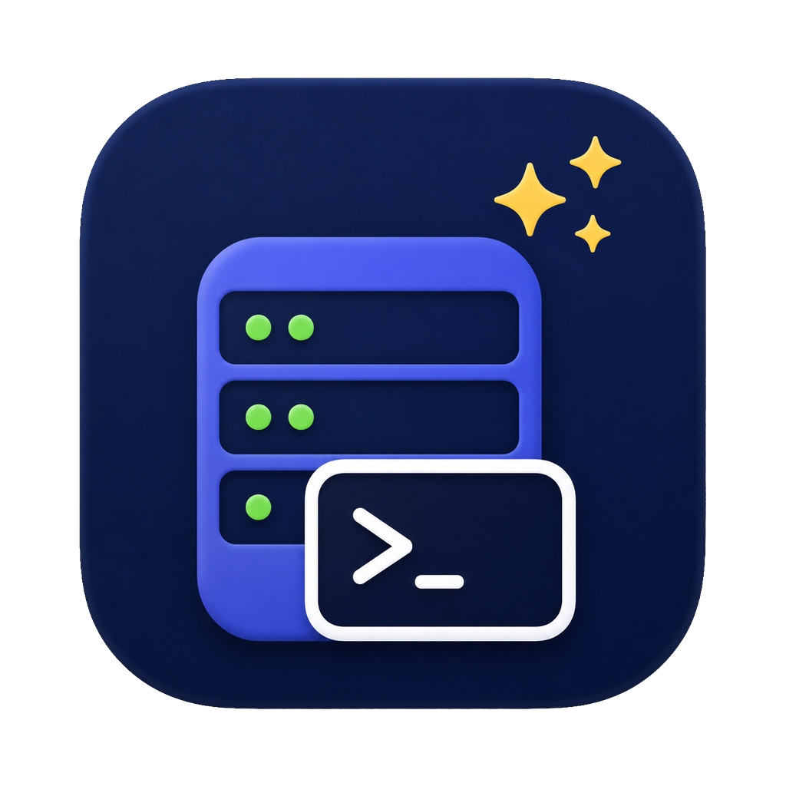

<div align="center">
  
  <h1>Despatch</h1>
  <p><strong>A native macOS menu-bar launcher for the servers you SSH into.</strong></p>
</div>

Despatch lives in the menu bar. Click its item and a panel drops down with your SSH connections,
kept in one organised, human-readable JSON file; double-click one and it opens in your
terminal. It stores no secrets, and it never owns the session it starts — it hands the command to
your terminal and gets out of the way.

- **Servers** are grouped in the sidebar; a group's categories are pills above its list of
  connections.
- The config file lives wherever you point it — a synced folder or a git repo, so the same set of
  connections follows you between machines.
- **Recently used** lists what you opened last on this Mac, and search reaches everything at once.
- Machine-local choices (which config file, appearance, terminal, launch history) stay out of that
  shared file.

## Install

Download the disk image from [Releases](../../releases), open it, and drag **Despatch** to
Applications. Run it from Applications, not from the disk image.

Despatch is **not signed with an Apple Developer ID**, so macOS quarantines the download and
refuses to open it. Clear the flag once:

```sh
xattr -dr com.apple.quarantine /Applications/Despatch.app
```

Right-click → Open no longer works as a bypass on macOS 15 and later; the alternative is
System Settings → Privacy & Security → **Open Anyway**.

Requires macOS 13 or later. The release build is universal (Apple silicon and Intel).

## Build from source

```sh
make run     # build the app bundle and run it, with output attached to this terminal
make bundle  # build Despatch.app only
make dmg     # build the universal release disk image
make check   # fmt, clippy, and the full test suite
```

Despatch has no Dock icon and no window of its own: it appears as a terminal symbol in the menu bar
and opens its panel once at launch. Right-click the item for Settings and Quit, or press ⌘Q while
the panel is open. A bare `cargo run` works too; the app name and icon come from the surrounding
bundle, which is why `make run` builds one first.

## How launching works

macOS has no "default terminal" setting. What it has is a Launch Services handler for
`public.unix-executable`, which is what every terminal's own "set as default terminal" button
writes. Despatch reads that choice and hands your command to that terminal. With nothing set, the
command goes to Terminal.app.

Ghostty is a special case: it is driven through its scripting interface rather than a command-line
flag, because its `-e` option asks you to confirm every executable. That path needs Ghostty 1.3 or
later with `macos-applescript` enabled, and the first launch asks macOS for permission to automate
it.

## Configuration

The config file defaults to `~/Library/Application Support/Despatch/config.json` and can be moved
anywhere from Settings. It is versioned, human-readable, and safe to keep under version control.

**Despatch never writes secrets to it** — no passwords, no API tokens, no private-key contents.
Identity files are referenced by path, not by content.

## Development

`AGENTS.md` is the authoritative guide to the codebase: the layer boundaries, the design system,
and the reasoning behind the launch path. Read it before changing the main layout or the way a
command reaches a terminal.

The workspace is a ports-and-adapters layout:

| Crate | Role |
| --- | --- |
| `despatch-domain` | Groups, launchers, validation. No I/O. |
| `despatch-application` | Use cases and the port traits every adapter implements. |
| `despatch-config` | Versioned JSON persistence with conflict detection. |
| `despatch-platform-macos` | Launch Services, terminals, `NSUserDefaults`, SF Symbols. |
| `despatch-probe` | TCP reachability checks. Never authenticates. |
| `despatch-ui-iced` | The Iced/wgpu interface. |

The UI reference images `AGENTS.md` points at are not in the repository; the design rules it states
in prose are the part that is binding.

## License

Dual-licensed under either of

- Apache License, Version 2.0 ([LICENSE-APACHE](LICENSE-APACHE))
- MIT license ([LICENSE-MIT](LICENSE-MIT))

at your option. Unless you state otherwise, any contribution you intentionally submit for inclusion
in this work shall be dual-licensed as above, with no additional terms or conditions.

### Third-party assets

- **Lilex** (`crates/despatch-ui-iced/assets/fonts/`) is licensed under the SIL Open Font License
  1.1, whose text sits beside the font files in
  [`OFL.txt`](crates/despatch-ui-iced/assets/fonts/OFL.txt).
- The Claude and Codex marks in `crates/despatch-ui-iced/assets/logos/` are trademarks of their
  respective owners and are used only to identify those tools.
